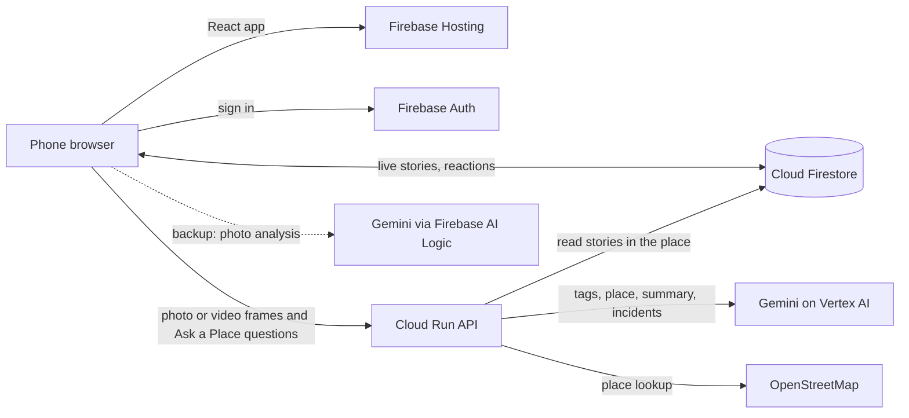

# Jomisu: What's Happening Now?

**Jomisu** (Hokkien for *"what is happening?"*) is a real-time, map-first app where people post
24-hour photo stories about what they see (an accident, a blocked lane, a crowd at a mall event),
so anyone, anywhere, can find out what's happening at a place **before it reaches the news**.

Built by **ChiMi Studio** for the **Google Cloud AI Builder Cup 2026**.
Theme: Sustainability & Social Impact.

| | |
|---|---|
| 🌐 **Live prototype** | https://jomisu.web.app |
| ⚙️ **API (Cloud Run)** | https://jomisu-api-236629246156.asia-southeast1.run.app/health |
| 📍 **Demo location** | Penang, Malaysia (Second Bridge and Gurney) |

---

## Try it in 2 minutes (for judges)

1. Open **https://jomisu.web.app** (phone recommended) and allow location.
   The welcome card confirms *"You are here"*, then tap **🗺️ Show me the Penang demo**.
   You can jump back any time with **🇲🇾 Demo** (to Penang) or **📍** (to yourself).
2. **One dot per incident.** On the Second Bridge, the **red dot with "3"** is one accident reported
   by 3 people (Confirmed). Yellow = 1 report (Unconfirmed), orange = 2 (Likely).
   Tap it and **swipe** through all 3 stories.
3. **Ask a Place** with Gemini. Type in the top bar, for example:
   - `Any accident on Penang Second Bridge?`
   - `What happened at Gurney?`

   Gemini reads the live stories inside the whole place (the full 24 km bridge, or the Gurney area),
   groups them into incidents, and answers with a summary. The map zooms out to show the area.
4. **Stories tab.** A list of live stories with the place name (e.g. *Second Bridge · KM 6*,
   *Gurney Drive, George Town*) and distance. Tap any story to open it.
5. **Post a story** (📷, Google sign-in). Take or choose a photo/video, pick a category, then
   **✨ Analyse with AI**: Gemini suggests the category, a one-line summary, severity and flags
   sensitive content *before* you post. You can keep your own category or use the AI's.

Demo stories are labelled **🧪 Demo** and use drawn pictures (no real people or number plates).

---

## How we use Google Cloud

| Service | What it does in Jomisu |
|---|---|
| **Firebase Hosting** | Serves the React web app at jomisu.web.app |
| **Firebase Authentication** | Google sign-in to post and react; browsing needs no account |
| **Cloud Firestore** | Stores stories (photo, category, AI tags, location, 24 h expiry), emoji reactions and user profiles; the app listens live, so new stories appear instantly |
| **Cloud Run** (`api/`, Python/Flask) | Two APIs: **/analyse** (story analysis) and **/ask** (Ask a Place: reads live stories from Firestore, finds the place) |
| **Gemini on Vertex AI** (from Cloud Run) | (1) Analyses a photo, or frames from the first 5 s of a video, before posting: category, summary, severity, confidence, sensitive-content and faces/plates flags, place detail. (2) Ask a Place: extracts the place from the question, summarises the stories there and groups them into incidents (Unconfirmed / Likely / Confirmed). Strict JSON via response schemas; a lighter model takes over if the main one is busy |
| **Gemini via Firebase AI Logic** | Automatic backup for story analysis, called straight from the browser if Cloud Run is unreachable |



Map tiles, place search and area names come from **OpenStreetMap** (free). Penang's two bridges
are stored as real road lines, so a story gets a KM position (e.g. *KM 6*) and its dot sits on the road.

---

## Key features
- **Map-first** home that opens at your location, plus a one-tap jump to the Penang demo
- **24-hour stories** (photo, or one frame from a 5-second video), exact or approximate (~500 m) location
- **Gemini auto-tagging with a preview**: the user confirms or overrides the AI's category; posting without AI is also allowed
- **Sensitive photos blurred** with a "tap to view" warning
- **One dot per incident**, coloured by how many people reported it; swipe through all its stories
- **Ask a Place**: ask about any named place in the world (a bridge, a mall, a town, or "near me")
- **Emoji reactions** using the phone's own emoji keyboard

## Repository structure
```
src/              React app (Vite)
  App.jsx         screens: Map, Stories, Ask a Place card, story viewer, post form, profile
  gemini.js       story analysis: Cloud Run /analyse first, Firebase AI Logic as backup
  geo.js          distances, bridge KM labels, dots on the bridge road, area names
  bridges.js      real centre lines of Penang's two bridges (generated from OpenStreetMap)
  firebase.js     Firebase app, Auth and Firestore setup
api/              Cloud Run service (Python/Flask)
  main.py         /health, /analyse and /ask endpoints
  ai.py           Gemini on Vertex AI: story analysis, place extraction, summary/incident grouping
  geo.py          places (areas and bridge routes), OpenStreetMap geocoding
  seed_demo.py    seeds the labelled Penang demo stories
  bridge_points.py fetches the bridges' real road shape -> src/bridges.js
firestore.rules   security rules (anyone reads; signed-in users post; others may only react)
```

## Run and deploy
Front end (Node 20+):
```bash
npm install
npm run dev                                   # local
npm run build && firebase deploy --only hosting
```
Cloud Run API:
```bash
gcloud run deploy jomisu-api --source api --region asia-southeast1 --allow-unauthenticated \
  --max-instances 2 --memory 512Mi \
  --set-env-vars GOOGLE_CLOUD_PROJECT=jomisu,GEMINI_MODEL=gemini-3.8-flash
```
Demo data: `python api/seed_demo.py` (needs `google-cloud-firestore`).

## Privacy and safety notes
- Approximate location option rounds the spot to about 500 m.
- Photos are compressed in the browser; for videos, only one still frame is saved.
- Sensitive content is blurred; Gemini flags faces and number plates (automatic blurring is planned).
- No secrets are stored in this repo. The Firebase web config is public by design; access is controlled by `firestore.rules`.

## Roadmap (not built yet: future versions)
- Automatic face and number-plate blurring (Gemini already flags them), plus manual blur/sticker tools
- Comments on stories (verified users, AI-moderated) and the Chat tab
- Feed tab: credible local news from the past week (shows "coming soon" today)
- Archive of your expired stories on the Profile page
- Trust scores for reporters
- "Report to authorities" button
- Traffic and authority data integrations, and more seeded demo cities (the app already works anywhere; today's demo data is in Penang)

Build history: [BUILD_LOG.md](BUILD_LOG.md)
